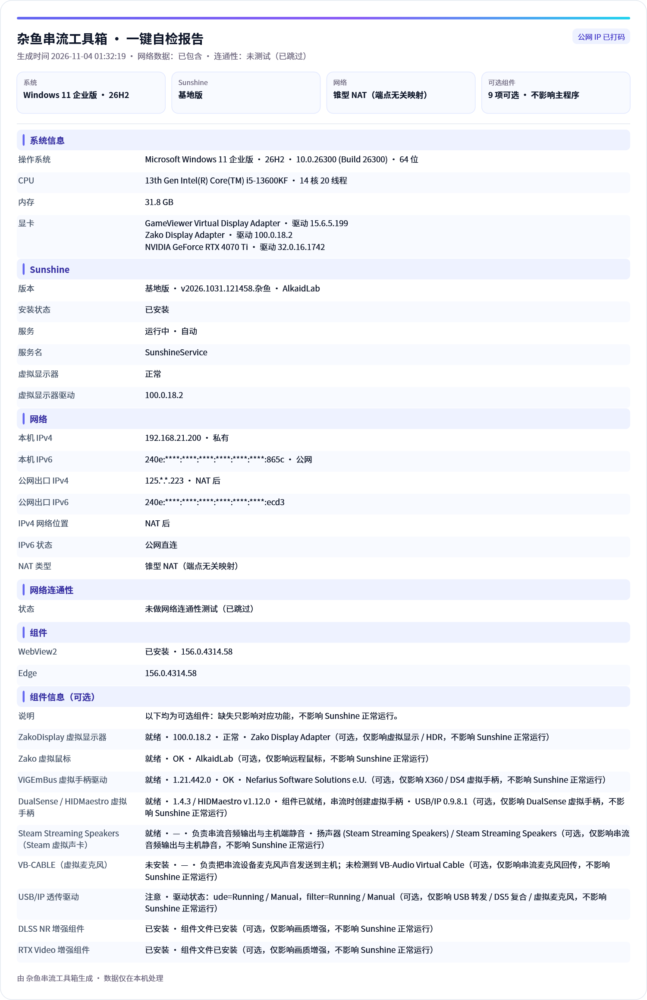

# 杂鱼串流工具箱

> 面向串流与网络排查的 Windows 小工具 · v1.8 beta · 作者 BlackCat

杂鱼串流工具箱把「查看 IP、判断 NAT、测试 P2P 连通性、检查 Sunshine 环境和组件、一键自检」放在一个界面里，专门解决串流前的网络与环境排查。


## 主要功能

- **IP 与网络状态**：列出本机 IPv4 / IPv6，识别公网、私有、CGNAT、链路本地和 ULA；默认只遮罩公网 IP，局域网地址保持完整。
- **公网出口与 NAT**：通过 STUN 获取公网出口，判断公网直连 / NAT 类型，并给出能否建立 P2P 的一句话结论。
- **连通性测试**：内网 / 外网 × IPv4 / IPv6 四象限测试，手机扫码即可验证；支持同一 Wi-Fi 与移动数据两种模式。
- **Sunshine 环境检查**：检查 Sunshine 版本、服务状态、Zako 显示适配器与开机自启，可直接打开基地版官网。
- **组件状态**：按基础环境、显示与输入、音频、USB 透传、画质增强分组检查，并支持修复 / 卸载支持的组件。
- **一键自检**：汇总系统、Sunshine、网络、WebView2 与可选组件，支持复制为截图。
- **更新检查**：启动时后台检查 GitHub Release，不弹窗、不打断操作。

## 界面





## 下载与运行

- 系统：Windows 10 / 11 x64
- 运行时：.NET Framework 4.8
- 发布文件：单个 `杂鱼串流工具箱.exe`，无需安装，双击运行
- 需要管理员权限的功能（服务自启、组件修复 / 卸载）会在操作时单独请求 UAC

下载地址：[GitHub Releases](https://github.com/BlackShinex/ZayuToolbox/releases)

## 隐私

- 网络检测和二维码生成全部在本机完成，不上传 IP 或测试数据。
- 报告截图默认遮罩公网 IP，只有点击「显示 IP」才会完整显示。
- 更新检查仅访问 GitHub API，不发送本机信息。

## 构建

需要 Windows 自带的 .NET Framework 4.8 和 MSBuild，不需要 .NET SDK。

```powershell
# Debug
.\tools\build.ps1

# Release，并把单文件 exe 输出到 dist\
.\tools\build.ps1 -Release -Package
```

测试：

```powershell
# 核心逻辑与网络探测（构建测试项目后运行）
& (Get-ChildItem .\tests -Recurse -Filter '*Tests.exe' |
    Where-Object { $_.FullName -match '\\Release\\' } |
    Select-Object -First 1).FullName

# 后台 UI 冒烟测试（不抢当前桌面）
.\tools\ui-test-background.ps1

# 只测修改部分
.\tools\ui-test-background.ps1 -Only components,selfcheck
```

完整 UI 测试覆盖 83 项后台检查 / 90 项前台检查，核心测试覆盖 186 项离线检查。

## 技术说明

- WPF / .NET Framework 4.8，经典非 SDK 工程。
- 界面字体：随程序嵌入的思源黑体 Source Han Sans SC，数字与地址使用 Noto Sans Mono。
- 二维码由 QRCoder 在本机离线生成；程序以单文件 exe 形式发布。
- 无边框圆角窗口，标题栏、窗口按钮与主体一体化。

## 许可

- 本项目代码：MIT License，见 [LICENSE](LICENSE)。
- 第三方组件与字体许可见 [THIRD-PARTY-NOTICES.md](THIRD-PARTY-NOTICES.md) 和 [LICENSES](LICENSES)。

## 更新记录

见 [CHANGELOG.md](CHANGELOG.md)。
