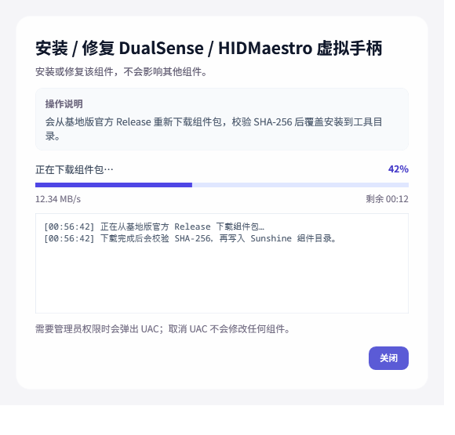

# 杂鱼串流工具箱

> 作者：**BlackCat** · 版本：**1.7**

**杂鱼串流工具箱**是一个面向串流与网络排障的 Windows 工具箱：查看本机 IPv4 / IPv6 地址、公网出口，检测当前网络是否在公网、属于哪种 NAT 类型，提供 **网络连通性测试（内网 / 外网 × IPv4 / IPv6）**、**手机扫码连接**，并集成 **WebView2 运行库检测与安装修复**。默认对 IP 中间部分打码，支持一键显示和逐条复制。




## 功能

- **本机 IPv4 / IPv6 地址列表**
  - 自动枚举所有已启用的网卡，标记主地址与网卡类型
  - 地址类型标签：公网 / 私有 / CGNAT / 链路本地 / 唯一本地等
- **隐私遮罩（默认开启，只遮公网 IP）**
  - 局域网 IPv4（10/8、172.16/12、192.168/16、CGNAT）保持完整，方便排查内网
  - 公网 IPv4：`125.113.211.223` → `125.*.*.223`
  - 公网 IPv6：`2400:3200:1234:5678:9abc:def0:1111:2222` → `2400:****:****:****:****:****:****:2222`
  - 链路本地 / ULA IPv6 保持完整；右上角「显示 IP / 隐藏 IP」可随时切换
- **一键复制**
  - 每个地址右侧都有「复制」按钮，**始终复制完整 IP**（即使界面处于遮罩状态）
- **公网 IP 检测**
  - 使用自研 RFC 5389 STUN 客户端（UDP）获取公网出口 IPv4 与端口、公网 IPv6
  - 判断 IPv4 / IPv6 是公网直连还是位于 NAT 之后，并给出一句话结论
- **NAT 类型检测**
  - 同一个本地 UDP 套接字向多台（不同公网 IP 的）STUN 服务器发起绑定请求，比较映射是否一致
  - 输出：映射行为（端点无关 / 端点相关）、端口是否保持、NAT 类型
  - 支持识别：公网直连（无 NAT）、对称型 NAT、锥型 NAT
  - 全锥 / 限制锥的进一步细分依赖 RFC 3489 的 CHANGE-REQUEST 过滤测试，公共 STUN 服务器基本不支持，因此通常显示「锥型 NAT（端点无关映射）」，并在「查看检测详情」中明确标注过滤行为未知
- **网络连通性测试（内网 / 外网 × IPv4 / IPv6）**
  - 用一张 2×2 矩阵同时展示「内网 IPv4 / 内网 IPv6 / 外网 IPv4 / 外网 IPv6」四项结果
  - **同一 Wi-Fi 模式**：二维码指向电脑的局域网地址，手机扫码后网页同时探测内网 IPv4 与 IPv6，验证同一局域网内能否直连
  - **移动数据模式**：二维码指向公网 IPv6，手机关闭 Wi-Fi 用 4G/5G 扫码，验证公网 IPv6 入站是否被光猫 / 路由器 / Windows 防火墙拦截
  - 电脑侧另外主动连接公共 IPv4 TCP 端口，并结合 STUN 得到的 NAT 类型，判断 IPv4 打洞可行性
  - 结论优先推荐 IPv6 直连；IPv4 锥型 NAT 提示可打洞；对称 NAT 提示可能需要中继；IPv4 / IPv6 都不通则明确提示「无法建立有效 P2P 连接」
  - 二维码在本机离线生成（QRCoder 嵌入 exe），测试地址带随机令牌，测试结束或 90 秒超时后自动关闭临时端口
  - 保留手动复制地址的打开方式；说明窗口带 6 秒倒计时，关闭按钮为「完成并关闭」
  - 显示 Windows 防火墙状态（管理员权限不足时从注册表推断，并明确标注“推断”）
- **主地址智能选择**
  - 优先使用系统实际选路的物理网卡（`GetBestInterface` + 网关 + 地址类型综合判断）
  - 自动识别 VMware / VirtualBox / Hyper-V / WSL / Docker / VPN / Tailscale / 蓝牙等虚拟网卡，避免它们抢走「主地址」；虚拟网卡仍会列出并标注
- **Sunshine 基地版官网入口**
  - Sunshine 环境页右上角提供「Sunshine 基地版官网」按钮，跳转 `https://www.alkaidlab.cn/`
- **版本更新检测**
  - 启动时从 GitHub `BlackShinex/ZayuToolbox` 的 Release / Tag 自动检查更新
  - 有新版本时只在左下角显示「发现新版本 vX.Y」和「查看更新」，不弹窗、不打断操作
  - 已是最新时显示「已是最新版本」，网络失败时显示失败原因并允许重新检查
- **界面字体**
  - 界面使用随程序嵌入的 Noto Sans SC，数字 / 地址使用 Noto Sans Mono
  - 两者均为 SIL Open Font License 1.1，不依赖系统微软雅黑或 Consolas
- **一键自检**
  - 自动汇总系统版本、CPU、内存、显卡型号与驱动版本
  - 汇总 Sunshine 版本、安装状态、服务运行 / 启动类型、虚拟显示器及驱动版本
  - 汇总本机 IPv4 / IPv6、公网出口、是否为公网 IP、NAT 类型
  - 如果做过网络连通性测试，自动纳入 2×2 结果与 P2P 结论；没做过则标注「已跳过」
  - 汇总 WebView2 / Edge 等组件信息
  - 汇总可选功能组件状态，并标明缺失只影响对应功能、不影响 Sunshine 正常运行
  - 报告默认对 IP 打码，可切换「显示 IP / 隐藏 IP」；支持一键复制为截图
- **基地版组件状态**
  - 状态检测 ZakoDisplay 虚拟显示器、Zako 虚拟鼠标、DualSense / HIDMaestro 虚拟手柄、ViGEmBus 虚拟手柄驱动
  - 检测 ViGEmBus 驱动文件版本、PnP 总线状态与服务状态，要求 v1.17 或更高；使用基地版 `scripts\install-gamepad.bat` / `uninstall-gamepad.bat` 安装、修复或卸载
  - 检测 Steam Streaming Speakers（Steam 虚拟声卡）、VB-CABLE（虚拟麦克风）
  - 检测 USB/IP 透传驱动与 HIDMaestro UDE 主机设备
  - 检测 DLSS NR / RTX Video 画质增强组件文件
  - 显示安装 / 驱动 / 运行状态、版本、设备 ID，并提供复制诊断、设备管理器、工具目录入口
  - ZakoDisplay、Zako 虚拟鼠标、DualSense 支持单独「修复 / 卸载」；DualSense 按基地版 `tools\ds5-sidecar-package.json` 中的官方 Release 地址下载完整 `Sunshine.Ds5Sidecar.x64.zip`，校验 SHA-256、组件版本、协议、HIDMaestro 版本和 USB/IP 0.9.8.1 兼容性，并生成包含 `hidmaestro_version` 的 `component.json` 后再安装
  - Steam Streaming Speakers 使用 Steam 自带 INF 重新安装；USB/IP 从官方 Release 下载 0.9.8.1 安装包并校验 SHA-256
  - USB/IP 版本读取卸载注册表，已安装 0.9.8.1 时跳过重复下载；安装结束后继续 Sidecar 步骤，不因驱动暂未运行而中断
  - Sunshine Virtual Microphone 不是独立驱动，不列入组件状态；它由 DualSense 虚拟设备宿主在串流时通过 USB/IP 创建
  - 一键自检新增「组件信息（可选）」：列出各功能组件状态，并标明缺失只影响对应功能、不影响 Sunshine 正常运行
  - 未安装的组件只显示「安装」；已安装组件才显示「修复 / 卸载」，避免未安装时出现卸载按钮
  - 说明哪些设备是按需创建：未启动串流时显示「未创建」并不代表组件损坏
- **WebView2 运行库检测与修复**
  - 读取 Edge Update 注册表，并与 `msedgewebview2.exe` 安装目录交叉验证，区分「已安装 / 未安装 / 安装异常」
  - 显示运行库版本、安装范围、系统架构、安装路径、检测来源、Edge 浏览器版本与当前权限
  - 支持复制完整诊断信息、打开安装目录、访问 Microsoft 官方下载页
  - 「安装 / 修复」会从 Microsoft 官方短链下载 Evergreen Bootstrapper，校验 Microsoft Authenticode 数字签名后静默安装
  - 普通用户可以安装到当前用户，也可以勾选「为所有用户安装」触发 UAC；也支持选择本地 WebView2 安装包离线安装
- **单文件发布**
  - `IpInfo.Core` 的源码在构建时直接编译进主程序，发布包只需要 exe 与配置文件
  - 二维码生成库 QRCoder 以嵌入资源形式随 exe 发布，不需要额外的 DLL
- **高分屏适配**
  - 清单启用 Per-Monitor V2 DPI 感知，并配置 WPF `DoNotScaleForDpiChanges=false`
  - 窗口启动/跨屏移动时自动限制在当前屏幕可用区域内，125% / 150% 缩放下不会超出屏幕；内容用 ScrollViewer 兜底
- **键盘焦点样式**
  - 全局关闭键盘焦点虚线框；按 Ctrl+Alt 切回窗口时不会出现虚线框
- 检测异步执行，不阻塞界面；检测失败时仍会显示本机地址
- 所有数据仅在本机处理，不上传到任何第三方服务

## 直接运行

双击 `dist\杂鱼串流工具箱.exe` 即可。要求 Windows 10 / 11（自带 .NET Framework 4.8），无需安装 .NET SDK。

> 首次运行如需联网，请允许 Windows 防火墙的“专用/公用网络”访问（程序使用 UDP 访问公共 STUN 服务器、使用 TCP 探测公网出口；启动网络连通性测试时会临时监听 TCP 端口）。安装 / 修复 WebView2 时还会访问 Microsoft 官方服务器下载安装包。

## 下载发布版

从 GitHub **Releases** 下载 `ZayuToolbox-1.7-win-x64.zip`，解压后双击 `杂鱼串流工具箱-1.7\杂鱼串流工具箱.exe` 运行。  
压缩包内含 `杂鱼串流工具箱.exe`、`杂鱼串流工具箱.exe.config`（高分屏配置）和 README。`IpInfo.Core` 的源码在构建时直接编译进 exe，不再单独分发 DLL。

也可以按下一节从源码自行构建。

## 从源码构建

只需要 Windows 自带的 .NET Framework 4.8 与 MSBuild，**不需要安装 .NET SDK**：

```powershell
powershell -ExecutionPolicy Bypass -File .\tools\build.ps1 -Release -Package -Zip
```

- 构建产物：`src\IpInfo.App\bin\Release\杂鱼串流工具箱.exe` 和 `杂鱼串流工具箱.exe.config`（Core 源码已编译进 exe，不再生成独立 DLL）
- `-Package` 会把可运行文件复制到 `dist\`
- `-Zip` 会额外生成 `dist\ZayuToolbox-1.7-win-x64.zip`，解压后双击 `杂鱼串流工具箱-1.7\杂鱼串流工具箱.exe` 即可运行
- 也可以使用 Visual Studio 2019/2022 打开 `IpInfo.sln`（经典 .NET Framework WPF 项目）直接构建、调试

## 测试

```powershell
# 1) 核心逻辑 + 真实网络探测（186 项离线检查；--live 额外 5 项联网检查）
powershell -ExecutionPolicy Bypass -File .\tools\build.ps1 -Debug -Tests
.\tests\IpInfo.CoreTests\bin\Debug\IpInfo.CoreTests.exe --live

# 2) 后台 UI 冒烟测试：在独立 Windows 桌面运行，不抢当前桌面焦点
#    自动跳过 7 项依赖剪贴板内容的校验，83 项检查
powershell -ExecutionPolicy Bypass -File .\tools\ui-test-background.ps1

# 3) 前台完整 UI 冒烟测试：包含剪贴板内容校验，90 项检查（会短暂占用桌面）
powershell -ExecutionPolicy Bypass -STA -File .\tools\ui-smoke-test.ps1

# 4) 只测修改部分（速度快，不跑网络探测 / 连通性测试）
powershell -ExecutionPolicy Bypass -File .\tools\ui-test-background.ps1 -Only components
powershell -ExecutionPolicy Bypass -File .\tools\ui-test-background.ps1 -Only sunshine,webview2
powershell -ExecutionPolicy Bypass -File .\tools\ui-test-background.ps1 -Only selfcheck
```

`-Only` 支持 `components`、`sunshine`、`webview2`、`selfcheck`，多个分区用逗号分隔；例如只改组件状态页时运行 `-Only components` 约 5 秒，只改服务卡片时运行 `-Only sunshine` 约 4 秒。发布前仍建议跑一次完整后台测试。

后台模式通过 `CreateDesktop` 创建独立桌面，并在该桌面启动应用与 UI Automation，当前桌面不会出现窗口或抢焦点；由于非输入桌面无法可靠访问剪贴板，后台模式会跳过诊断复制、IP 复制、报告截图等 7 项剪贴板内容校验。需要完整校验时再运行前台模式。

前台 UI 冒烟测试会通过 UI Automation 操作离屏窗口，校验 90 项行为，包括：默认遮罩、复制得到完整 IPv4/IPv6、显示/隐藏切换、网络连通性测试窗口的二维码与 6 秒倒计时、回环 IPv4/IPv6 探测后矩阵变为「连通」并给出 P2P 结论、一键自检报告与复制截图、基地版组件状态页，以及 WebView2 状态卡片、诊断复制和安装窗口。

> 仓库已包含 `.github/workflows/build.yml`：推送到 GitHub 后会自动构建 Release、运行离线核心测试并上传构建产物。

## 发布到 GitHub

仓库已经按 GitHub 项目结构整理好（`.gitignore`、`.gitattributes`、`.editorconfig`、Actions、LICENSE 等）。首次发布步骤见 [GITHUB_PUBLISH.md](GITHUB_PUBLISH.md)。

## 目录结构

```
ip-info/
├─ IpInfo.sln
├─ .github/workflows/build.yml   GitHub Actions 自动构建
├─ src/
│  ├─ IpInfo.Core/               核心库（无 WPF 依赖）
│  │  ├─ Models.cs               数据模型（NetworkReport / NatResult / PublicIpInfo）
│  │  ├─ IpPrivacy.cs            IP 遮罩
│  │  ├─ IpClassifier.cs         地址类型判断
│  │  ├─ IpNetworkHelper.cs      网段 / 子网判断
│  │  ├─ LocalAddressProvider.cs 本机地址枚举 + 主地址智能选择
│  │  ├─ WindowsFirewallReader.cs Windows 防火墙状态读取（COM + 注册表降级）
│  │  ├─ ConnectivityTestServer.cs 双栈 TCP 测试服务器（内网 / 公网页面 + IPv4/IPv6 探测）
│  │  ├─ ConnectivityProbe.cs    公网 IPv4 / IPv6 TCP 出口探测
│  │  ├─ ConnectivityEvaluator.cs 2×2 连通性矩阵与 P2P 结论
│  │  ├─ SelfCheckCollector.cs    一键自检：系统 / Sunshine / 网络 / 组件汇总
│  │  ├─ ComponentStatusDetector.cs 基地版组件状态（PnP / 驱动 / 音频 / USB）
│  │  ├─ ComponentOperationService.cs 组件修复 / 卸载（INF、官方 ZIP、UAC）
│  │  ├─ ComponentOperationModels.cs 组件操作白名单 / 进度模型
│  │  ├─ VersionUpdateService.cs GitHub Release / Tag 版本检查
│  │  ├─ WebView2DetectionService.cs WebView2 注册表 / 安装目录检测
│  │  ├─ WebView2InstallerService.cs WebView2 下载、签名校验与静默安装
│  │  ├─ StunClient.cs           RFC 5389 STUN 客户端
│  │  ├─ StunServers.cs          公共 STUN 服务器解析
│  │  ├─ NatDetector.cs          NAT 映射 / 过滤行为检测
│  │  └─ NetworkProbe.cs         组合完整探测报告
│  └─ IpInfo.App/                WPF 界面
│     ├─ App.xaml(.cs)
│     ├─ MainWindow.xaml(.cs)
│     ├─ ConnectivityTestDialog.xaml(.cs) 网络连通性测试窗口（二维码 + 说明 + 倒计时）
│     ├─ QrCodeRenderer.cs       离线二维码渲染（QRCoder 模块矩阵 → WPF 位图）
│     ├─ lib/QRCoder.dll         嵌入到 exe 的二维码生成库（MIT）
│     ├─ Assets/Fonts/            嵌入的 Noto Sans SC / Noto Sans Mono（OFL）
│     ├─ WebView2InstallDialog.xaml(.cs) WebView2 安装 / 修复窗口
│     ├─ ComponentOperationDialog.xaml(.cs) 组件修复 / 卸载进度窗口
│     ├─ UiModels.cs
│     ├─ app.config                   Per-Monitor V2 DPI 配置
│     └─ app.ico
├─ LICENSES/                     第三方字体许可证（Noto OFL）
├─ tests/IpInfo.CoreTests/       无界面自测程序
├─ tools/
│  ├─ build.ps1                  构建 / 打包
│  ├─ ui-smoke-test.ps1          UI 自动化冒烟测试（前台完整版）
│  ├─ ui-test-background.ps1     在独立桌面运行 UI 测试，不抢焦点
│  └─ make-icon.py               生成应用图标（可选）
├─ docs/                         截图与图标预览
├─ dist/                         本地发布产物（已被 .gitignore 忽略）
├─ CHANGELOG.md                  版本记录
├─ THIRD-PARTY-NOTICES.md        第三方组件与许可证（QRCoder / Noto 字体）
├─ GITHUB_PUBLISH.md             首次发布到 GitHub 的步骤
├─ LICENSE                       MIT License
└─ README.md
```

## 实现说明

### 隐私遮罩规则

- 只遮罩公网 IP；局域网 IPv4、CGNAT、链路本地 IPv6、唯一本地 IPv6 保持完整
- 公网 IPv4 保留首、尾两段，中间两段替换为 `*`：`125.113.211.223` → `125.*.*.223`
- 公网 IPv6 保留第一个和最后一个 hextet，中间六个替换为 `****`：`2400:3200:1234:5678:9abc:def0:1111:2222` → `2400:****:****:****:****:****:****:2222`
- 遮罩只影响显示；「复制」始终复制完整地址
- 未显示 IP 时，摘要、NAT 描述和「检测详情」中出现的公网 IP 会一并遮罩，避免从文字中泄露

### NAT 检测原理与限制

1. 用同一个本地 UDP 套接字向多台公网 IP 互不相同的 STUN 服务器发送 Binding Request；
2. 比较各服务器观察到的映射地址（公网 IP + 端口）：
   - 全部一致 → 端点无关映射（锥型 NAT）
   - 不一致 → 端点相关映射（对称型 NAT）
3. 若映射公网 IP 与本机 IPv4 相同 → 公网直连（无 NAT）；
4. 尝试 CHANGE-REQUEST（改 IP/改端口）判断过滤行为。公共 STUN 基本不支持该属性，若服务器忽略请求，代码会检查响应来源是否真的变化，避免误报“全锥型”。

因此本工具能可靠区分「无 NAT / 锥型 NAT / 对称型 NAT」，并给出端口保持情况；全锥、限制锥、端口限制锥的细分受公共服务器能力限制，显示为「锥型 NAT」并注明过滤行为未知。

### 网络连通性测试

“能不能串流”最终取决于两台设备之间有没有可用的直连路径。程序用一张 2×2 矩阵分别验证：

| | 内网 | 外网 |
|---|---|---|
| **IPv4** | 手机与电脑同一 Wi-Fi 时，扫码访问电脑局域网 IPv4 | 电脑主动连接公共 IPv4 TCP 端口，并结合 STUN NAT 类型判断打洞可行性 |
| **IPv6** | 手机与电脑同一 Wi-Fi 时，扫码访问电脑局域网 IPv6 | 手机使用移动数据，扫码访问电脑公网 IPv6，验证入站是否放行 |

**同一 Wi-Fi 模式**

1. 电脑在本机局域网 IPv4（没有 IPv4 时回退 IPv6）上临时监听一个 TCP 端口；
2. 二维码内容是 `http://电脑局域网地址:端口/t/随机令牌/lan/`；
3. 手机连接同一 Wi-Fi 后扫码打开页面；页面里有两张隐藏图片，分别请求电脑的局域网 IPv4 与 IPv6 地址；
4. 服务器收到请求后记录协议族与来源地址，两项都到达即判定内网 IPv4 / IPv6 均可直连。

**移动数据模式**

1. 电脑同时监听公网 IPv6 地址，生成 `http://[公网 IPv6]:端口/t/随机令牌/wan/`；
2. 手机关闭 Wi-Fi、打开 4G/5G 后扫码；页面只探测公网 IPv6；
3. 页面能加载或探测请求到达，就说明公网 IPv6 入站没有被光猫 / 路由器 IPv6 防火墙或 Windows 防火墙拦截。

**判定规则**

- 外网 IPv6 可达：优先使用 IPv6 直连，P2P 可用；
- 外网 IPv6 不可达，但 IPv4 公网 TCP 出口可用且 NAT 为锥型 / 无 NAT：提示 IPv4 打洞可能成功；
- IPv4 为对称型 NAT：提示 P2P 可能需要中继；
- IPv4 外网不可用且没有公网 IPv6，或两者都被拦截：明确提示「无法建立有效 P2P 连接」。

> 注意：IPv4 外网检查是「本机到公共 TCP 端口的出站连通性 + STUN NAT 类型」，并不等同于“外部设备一定能连进来”。IPv4 没有公网地址时，真正能否 P2P 还取决于双方 NAT 类型、打洞实现和路由器行为。

二维码由 QRCoder 在本机离线生成，不经过任何二维码服务；测试地址带 16 位随机令牌，临时端口在测试窗口关闭或 90 秒超时后自动释放。二维码展示超过 8 秒仍没有收到连接时，会按「已尝试但未连通」记录，避免手机打不开页面时结果一直停在“等待中”。

### 二维码生成

`IpInfo.App/lib/QRCoder.dll` 以 `<EmbeddedResource>` 的形式编译进主 exe，`App` 在静态构造阶段注册 `AssemblyResolve`，运行时从嵌入资源加载。发布目录仍然只有 exe 与配置文件，不额外分发 DLL。QRCoder 使用 MIT 许可，详见 [THIRD-PARTY-NOTICES.md](THIRD-PARTY-NOTICES.md)。

### 主地址判定

1. 先排除链路本地 / APIPA（除非没有任何其他地址）；
2. 只要存在物理网卡候选，就完全不考虑虚拟网卡；
3. 优先系统 `GetBestInterface(8.8.8.8)` 返回的实际选路接口；
4. 再依次比较是否有网关、地址类型（公网 > 私有 > CGNAT > 唯一本地）；
5. 每个协议族只标记一个「主地址」，虚拟网卡仍会显示但排在物理网卡之后。

虚拟网卡识别综合了名称/描述关键字（VMware、VirtualBox、Hyper-V、WSL、Docker、VPN、Tailscale、WireGuard、蓝牙等）、接口类型（Tunnel / PPP / Loopback）以及已知虚拟化 MAC OUI（VMware/VirtualBox/Hyper-V/Parallels/Docker）。为避免误判，不使用 MAC 本地管理位单独判定（Windows 的“随机硬件地址”也会置位）。

### WebView2 运行库检测

- 从 `HKEY_LOCAL_MACHINE\SOFTWARE\WOW6432Node\Microsoft\EdgeUpdate\Clients\{F3017226-FE2A-4295-8BDF-00C3A9A7E4C5}` 与 `HKEY_CURRENT_USER\...` 读取 Evergreen 运行库版本和安装位置；
- 同时扫描系统级 / 当前用户安装目录，检查 `msedgewebview2.exe` 是否真实存在，避免把注册表残留误判为“已安装”；
- 注册表有记录但文件缺失 → 「安装异常」；没有记录且目录无有效版本 → 「未安装」；
- 只检测 Evergreen 运行库；应用自带的 Fixed Version WebView2 位于应用私有目录，不在此检测范围内。

安装 / 修复流程：

1. 从 `https://go.microsoft.com/fwlink/p/?LinkId=2124703` 下载 Evergreen Bootstrapper；
2. 使用 WinVerifyTrust 校验 Authenticode 签名，并要求签名主体为 Microsoft Corporation；
3. 普通用户默认安装到当前用户；勾选「为所有用户安装」时通过 UAC 提权；
4. 安装程序固定使用 `/silent /install`，15 分钟超时保护；支持选择本地安装包离线安装。

### 高分屏适配

- `app.manifest` 声明 `PerMonitorV2, PerMonitor` DPI 感知；
- `app.config` 设置 `Switch.System.Windows.DoNotScaleForDpiChanges=false`，跨显示器 DPI 变化时 WPF 自动缩放；
- 启动和跨屏移动时按当前显示器工作区（`MonitorFromWindow` / `GetMonitorInfo`）限制窗口大小与位置，125% / 150% 缩放不会超出可用区域；
- 窗口内容使用 ScrollViewer，小屏 / 高缩放下仍可完整操作。

### 依赖的公共 STUN 服务器

`stun.miwifi.com`、`stun.l.google.com`、`stun.cloudflare.com`、`stun.nextcloud.com`、`stun.voipbuster.com`、`stun.qq.com`（按顺序尝试，自动跳过不可用的；不经过 HTTPS，只发送标准 STUN 绑定请求）。

## 已知限制

- 需要 UDP 出网。公司/校园网封禁 UDP 时，公网 IP 与 NAT 类型会显示检测失败，但本机地址仍正常显示。
- 主地址按“物理网卡 > 系统选路接口 > 有网关 > 地址类型”综合选择，多网卡环境可能仍需结合网卡名称人工确认。
- 网络连通性测试需要另一台设备（手机）扫码访问；不扫码时只能看到电脑侧的公网 IPv4 出口探测与地址可用性。
- 同一 Wi-Fi 模式要求手机与电脑在同一局域网；开启 AP 隔离、访客网络或使用 VPN 时可能无法访问电脑的局域网地址。
- 移动数据模式要求电脑有公网 IPv6；没有公网 IPv6 时只能判断 IPv4 NAT 穿透可能性。
- 外网 IPv4 检查是「本机到公共 TCP 端口的出站连通 + STUN NAT 类型」，不等同于外部设备一定能连入；对称 NAT 或本机处于 CGNAT 时可能需要中继，优先尝试 IPv6。
- 二维码包含本次测试的地址与随机令牌，请勿截图分享；测试结束或 90 秒超时后临时端口会自动关闭。
- Windows 防火墙完整状态通常需要管理员权限；无权限时会显示注册表推断值，并明确标注「推断」。
- WebView2 在线安装需要访问 Microsoft 官方服务器；无法联网时可以选择本地 Evergreen Standalone Installer。
- WebView2 检测仅覆盖 Evergreen 运行库，不检测应用私有的 Fixed Version 目录。
- 一台 Windows 出现多个 IPv6 地址属正常现象（临时地址、链路本地地址等）。
- 部分公共 STUN 服务器可能临时不可用，程序会自动换下一台。
- 仅支持 Windows（WPF / .NET Framework 4.8）。

## 作者与版本

- 作者：BlackCat
- 版本：1.7
- **未发布（当前测试构建）**：移除多层 NAT 跃点跟踪；将 IPv6 入站自检重构为网络连通性测试，新增内网 / 外网 × IPv4 / IPv6 的 2×2 矩阵、手机扫码连接、离线二维码与 P2P 结论；新增一键自检与基地版组件状态页；界面字体改用嵌入的 Noto Sans SC / Noto Sans Mono。发布前版本号暂保持 1.7。
- v1.7：全新玻璃拟态侧边栏与分页 UI；恢复中文字体显示；更新 Sunshine 图标；新增 Sunshine 版本/服务/Zako 检测、多层 NAT 跃点跟踪；开机自启开关；修复基地版作者与剪贴板占用提示。
- v1.6：将 Core 源码编译进单文件 exe；WebView2 安装支持取消，并加固签名校验与启动之间的 TOCTOU；核心测试增至 64 项。
- v1.5：软件正式更名为「杂鱼串流工具箱」，同步更新窗口标题、程序名、图标文字、exe 文件名、发布包与文档。

## 许可证

本项目使用 [MIT License](LICENSE)。二维码生成使用 QRCoder（MIT），许可见 [THIRD-PARTY-NOTICES.md](THIRD-PARTY-NOTICES.md)。
