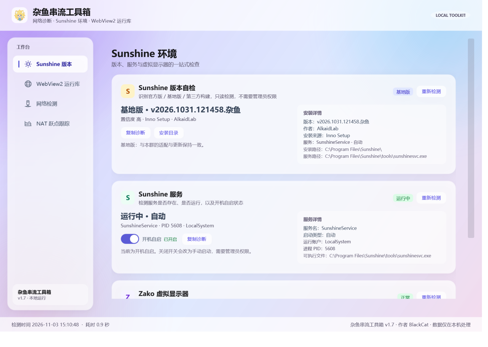

# 杂鱼串流工具箱

> 作者：**BlackCat** · 版本：**1.5**

**杂鱼串流工具箱**是一个面向串流与网络排障的 Windows 工具箱：查看本机 IPv4 / IPv6 地址、公网出口，检测当前网络是否在公网、属于哪种 NAT 类型，提供 **IPv6 入站可达性自检**，并集成 **WebView2 运行库检测与安装修复**。默认对 IP 中间部分打码，支持一键显示和逐条复制。



## 功能

- **本机 IPv4 / IPv6 地址列表**
  - 自动枚举所有已启用的网卡，标记主地址与网卡类型
  - 地址类型标签：公网 / 私有 / CGNAT / 链路本地 / 唯一本地等
- **隐私遮罩（默认开启）**
  - IPv4：`192.168.1.100` → `192.*.*.100`
  - IPv6：`2400:3200:1234:5678:9abc:def0:1111:2222` → `2400:****:****:****:****:****:****:2222`
  - 右上角「显示 IP / 隐藏 IP」按钮可随时切换
- **一键复制**
  - 每个地址右侧都有「复制」按钮，**始终复制完整 IP**（即使界面处于遮罩状态）
- **公网 IP 检测**
  - 使用自研 RFC 5389 STUN 客户端（UDP）获取公网出口 IPv4 与端口、公网 IPv6
  - 判断 IPv4 / IPv6 是公网直连还是位于 NAT 之后，并给出一句话结论
- **NAT 类型检测**
  - 同一个本地 UDP 套接字向多台（不同公网 IP 的）STUN 服务器发起绑定请求，比较映射是否一致
  - 输出：映射行为（端点无关 / 端点相关）、端口是否保持、NAT 类型
  - 支持识别：公网直连（无 NAT）、对称型 NAT、锥型 NAT
  - 全锥 / 限制锥的进一步细分依赖 RFC 3489 的 CHANGE-REQUEST 过滤测试，公共 STUN 服务器基本不支持，因此通常显示「锥型 NAT（端点无关映射）」，并在「查看检测详情」中明确标注过滤行为未知
- **主地址智能选择**
  - 优先使用系统实际选路的物理网卡（`GetBestInterface` + 网关 + 地址类型综合判断）
  - 自动识别 VMware / VirtualBox / Hyper-V / WSL / Docker / VPN / Tailscale / 蓝牙等虚拟网卡，避免它们抢走「主地址」；虚拟网卡仍会列出并标注
- **IPv6 入站可达性自检**
  - 显示 Windows 防火墙状态（管理员权限不足时从注册表推断，并明确标注“推断”）
  - 点击「启动入站自检」会弹出说明窗口：明确提示**必须关闭手机 Wi-Fi、改用 4G/5G 移动数据**，并将自测地址复制到手机浏览器打开
  - 说明窗口带 3 秒倒计时，倒计时结束前无法关闭；关闭按钮文字为「了解」
  - 程序会自动确认是否收到外部入站连接，从而判断光猫/路由器的 IPv6 防火墙是否放行
- **WebView2 运行库检测与修复**
  - 读取 Edge Update 注册表，并与 `msedgewebview2.exe` 安装目录交叉验证，区分「已安装 / 未安装 / 安装异常」
  - 显示运行库版本、安装范围、系统架构、安装路径、检测来源、Edge 浏览器版本与当前权限
  - 支持复制完整诊断信息、打开安装目录、访问 Microsoft 官方下载页
  - 「安装 / 修复」会从 Microsoft 官方短链下载 Evergreen Bootstrapper，校验 Microsoft Authenticode 数字签名后静默安装
  - 普通用户可以安装到当前用户，也可以勾选「为所有用户安装」触发 UAC；也支持选择本地 WebView2 安装包离线安装
- **高分屏适配**
  - 清单启用 Per-Monitor V2 DPI 感知，并配置 WPF `DoNotScaleForDpiChanges=false`
  - 窗口启动/跨屏移动时自动限制在当前屏幕可用区域内，125% / 150% 缩放下不会超出屏幕；内容用 ScrollViewer 兜底
- 检测异步执行，不阻塞界面；检测失败时仍会显示本机地址
- 所有数据仅在本机处理，不上传到任何第三方服务

## 直接运行

双击 `dist\杂鱼串流工具箱.exe` 即可。要求 Windows 10 / 11（自带 .NET Framework 4.8），无需安装 .NET SDK。

> 首次运行如需联网，请允许 Windows 防火墙的“专用/公用网络”访问（程序使用 UDP 访问公共 STUN 服务器；使用 IPv6 入站自检时会临时监听一个 TCP 端口）。安装 / 修复 WebView2 时还会访问 Microsoft 官方服务器下载安装包。

## 下载发布版

从 GitHub **Releases** 下载 `ZayuToolbox-1.5-win-x64.zip`，解压后双击 `杂鱼串流工具箱-1.5\杂鱼串流工具箱.exe` 运行。  
压缩包内含 `杂鱼串流工具箱.exe`、`IpInfo.Core.dll`、`杂鱼串流工具箱.exe.config`（高分屏配置）和 README。

也可以按下一节从源码自行构建。

## 从源码构建

只需要 Windows 自带的 .NET Framework 4.8 与 MSBuild，**不需要安装 .NET SDK**：

```powershell
powershell -ExecutionPolicy Bypass -File .\tools\build.ps1 -Release -Package -Zip
```

- 构建产物：`src\IpInfo.App\bin\Release\杂鱼串流工具箱.exe`、`IpInfo.Core.dll`、`杂鱼串流工具箱.exe.config`
- `-Package` 会把可运行文件复制到 `dist\`
- `-Zip` 会额外生成 `dist\ZayuToolbox-1.5-win-x64.zip`，解压后双击 `杂鱼串流工具箱-1.5\杂鱼串流工具箱.exe` 即可运行
- 也可以使用 Visual Studio 2019/2022 打开 `IpInfo.sln`（经典 .NET Framework WPF 项目）直接构建、调试

## 测试

```powershell
# 1) 核心逻辑 + 真实网络探测（63 项离线检查；--live 额外 5 项联网检查）
powershell -ExecutionPolicy Bypass -File .\tools\build.ps1 -Debug -Tests
.\tests\IpInfo.CoreTests\bin\Debug\IpInfo.CoreTests.exe --live

# 2) UI 冒烟测试（离屏启动，验证遮罩、复制、显示 IP、IPv6 弹窗倒计时、WebView2 卡片与安装弹窗）
powershell -ExecutionPolicy Bypass -STA -File .\tools\ui-smoke-test.ps1
```

UI 冒烟测试会通过 UI Automation 操作离屏窗口，校验 32 项行为，包括：默认遮罩、复制得到完整 IPv4/IPv6、显示/隐藏切换、IPv6 入站弹窗的「了解」按钮 3 秒倒计时、启动/停止/回环连接成功路径，以及 WebView2 状态卡片、诊断复制和安装窗口。

> 仓库已包含 `.github/workflows/build.yml`：推送到 GitHub 后会自动构建 Release、运行离线核心测试并上传构建产物。

## 发布到 GitHub

仓库已经按 GitHub 项目结构整理好（`.gitignore`、`.gitattributes`、`.editorconfig`、Actions、LICENSE 等）。首次发布步骤见 [GITHUB_PUBLISH.md](GITHUB_PUBLISH.md)。

## 目录结构

```
ip-info/
├─ IpInfo.sln
├─ .github/workflows/build.yml   GitHub Actions 自动构建
├─ src/
│  ├─ IpInfo.Core/               核心库（无 WPF 依赖）
│  │  ├─ Models.cs               数据模型（NetworkReport / NatResult / PublicIpInfo）
│  │  ├─ IpPrivacy.cs            IP 遮罩
│  │  ├─ IpClassifier.cs         地址类型判断
│  │  ├─ LocalAddressProvider.cs 本机地址枚举 + 主地址智能选择
│  │  ├─ WindowsFirewallReader.cs Windows 防火墙状态读取（COM + 注册表降级）
│  │  ├─ Ipv6InboundTestServer.cs IPv6 入站自检临时监听
│  │  ├─ WebView2DetectionService.cs WebView2 注册表 / 安装目录检测
│  │  ├─ WebView2InstallerService.cs WebView2 下载、签名校验与静默安装
│  │  ├─ StunClient.cs           RFC 5389 STUN 客户端
│  │  ├─ StunServers.cs          公共 STUN 服务器解析
│  │  ├─ NatDetector.cs          NAT 映射 / 过滤行为检测
│  │  └─ NetworkProbe.cs         组合完整探测报告
│  └─ IpInfo.App/                WPF 界面
│     ├─ App.xaml(.cs)
│     ├─ MainWindow.xaml(.cs)
│     ├─ InboundTestDialog.xaml(.cs)  IPv6 入站说明弹窗（3 秒倒计时）
│     ├─ WebView2InstallDialog.xaml(.cs) WebView2 安装 / 修复窗口
│     ├─ UiModels.cs
│     ├─ app.config                   Per-Monitor V2 DPI 配置
│     └─ app.ico
├─ tests/IpInfo.CoreTests/       无界面自测程序
├─ tools/
│  ├─ build.ps1                  构建 / 打包
│  ├─ ui-smoke-test.ps1          UI 自动化冒烟测试
│  └─ make-icon.py               生成应用图标（可选）
├─ docs/                         截图与图标预览
├─ dist/                         本地发布产物（已被 .gitignore 忽略）
├─ CHANGELOG.md                  版本记录
├─ GITHUB_PUBLISH.md             首次发布到 GitHub 的步骤
├─ LICENSE                       MIT License
└─ README.md
```

## 实现说明

### 隐私遮罩规则

- IPv4 保留首、尾两段，中间两段替换为 `*`：`192.168.1.100` → `192.*.*.100`
- IPv6 保留第一个和最后一个 hextet，中间六个替换为 `****`：`2400:3200:1234:5678:9abc:def0:1111:2222` → `2400:****:****:****:****:****:****:2222`
- 遮罩只影响显示；「复制」始终复制完整地址
- 未显示 IP 时，摘要、NAT 描述和「检测详情」中出现的本机/公网 IP 也会一并遮罩，避免从文字中泄露

### NAT 检测原理与限制

1. 用同一个本地 UDP 套接字向多台公网 IP 互不相同的 STUN 服务器发送 Binding Request；
2. 比较各服务器观察到的映射地址（公网 IP + 端口）：
   - 全部一致 → 端点无关映射（锥型 NAT）
   - 不一致 → 端点相关映射（对称型 NAT）
3. 若映射公网 IP 与本机 IPv4 相同 → 公网直连（无 NAT）；
4. 尝试 CHANGE-REQUEST（改 IP/改端口）判断过滤行为。公共 STUN 基本不支持该属性，若服务器忽略请求，代码会检查响应来源是否真的变化，避免误报“全锥型”。

因此本工具能可靠区分「无 NAT / 锥型 NAT / 对称型 NAT」，并给出端口保持情况；全锥、限制锥、端口限制锥的细分受公共服务器能力限制，显示为「锥型 NAT」并注明过滤行为未知。

### 主地址判定

1. 先排除链路本地 / APIPA（除非没有任何其他地址）；
2. 只要存在物理网卡候选，就完全不考虑虚拟网卡；
3. 优先系统 `GetBestInterface(8.8.8.8)` 返回的实际选路接口；
4. 再依次比较是否有网关、地址类型（公网 > 私有 > CGNAT > 唯一本地）；
5. 每个协议族只标记一个「主地址」，虚拟网卡仍会显示但排在物理网卡之后。

虚拟网卡识别综合了名称/描述关键字（VMware、VirtualBox、Hyper-V、WSL、Docker、VPN、Tailscale、WireGuard、蓝牙等）、接口类型（Tunnel / PPP / Loopback）以及已知虚拟化 MAC OUI（VMware/VirtualBox/Hyper-V/Parallels/Docker）。为避免误判，不使用 MAC 本地管理位单独判定（Windows 的“随机硬件地址”也会置位）。

### IPv6 入站自检

IPv6 没有 NAT，但光猫/路由器的 IPv6 防火墙和 Windows 防火墙仍可能拦截入站。由于无法从本机单方面证明“外部能主动连进来”，程序采用可验证的回调方式：

1. 在本机临时监听一个 IPv6 TCP 端口，生成 `http://[公网 IPv6]:端口/`；
2. 点击「启动入站自检」会弹出说明窗口：必须**关闭手机 Wi-Fi、打开 4G/5G 移动数据**，将地址复制到手机浏览器打开；
3. 说明窗口有 3 秒倒计时，倒计时结束前无法关闭，按钮文字为「了解」；
4. 若程序收到外部连接，会显示「检测成功」及来源地址，说明入站路径可达；若超时，则通常是光猫/路由器 IPv6 防火墙、Windows 防火墙或运营商拦截。

Windows 防火墙状态优先通过 `HNetCfg.FwPolicy2` COM 读取；普通用户权限不足时，降级读取注册表中的防火墙开关，并明确标注为“推断”（默认入站策略按 Windows 默认的“阻止”推断）。

### WebView2 运行库检测

- 从 `HKEY_LOCAL_MACHINE\SOFTWARE\WOW6432Node\Microsoft\EdgeUpdate\Clients\{F3017226-FE2A-4295-8BDF-00C3A9A7E4C5}` 与 `HKEY_CURRENT_USER\...` 读取 Evergreen 运行库版本和安装位置；
- 同时扫描系统级 / 当前用户安装目录，检查 `msedgewebview2.exe` 是否真实存在，避免把注册表残留误判为“已安装”；
- 注册表有记录但文件缺失 → 「安装异常」；没有记录且目录无有效版本 → 「未安装」；
- 只检测 Evergreen 运行库；应用自带的 Fixed Version WebView2 位于应用私有目录，不在此检测范围内。

安装 / 修复流程：

1. 从 `https://go.microsoft.com/fwlink/p/?LinkId=2124703` 下载 Evergreen Bootstrapper；
2. 使用 WinVerifyTrust 校验 Authenticode 签名，并要求签名主体为 Microsoft Corporation；
3. 普通用户默认安装到当前用户；勾选「为所有用户安装」时通过 UAC 提权；
4. 安装程序固定使用 `/silent /install`，15 分钟超时保护；支持选择本地安装包离线安装。

### 高分屏适配

- `app.manifest` 声明 `PerMonitorV2, PerMonitor` DPI 感知；
- `app.config` 设置 `Switch.System.Windows.DoNotScaleForDpiChanges=false`，跨显示器 DPI 变化时 WPF 自动缩放；
- 启动和跨屏移动时按当前显示器工作区（`MonitorFromWindow` / `GetMonitorInfo`）限制窗口大小与位置，125% / 150% 缩放不会超出可用区域；
- 窗口内容使用 ScrollViewer，小屏 / 高缩放下仍可完整操作。

### 依赖的公共 STUN 服务器

`stun.miwifi.com`、`stun.l.google.com`、`stun.cloudflare.com`、`stun.nextcloud.com`、`stun.voipbuster.com`、`stun.qq.com`（按顺序尝试，自动跳过不可用的；不经过 HTTPS，只发送标准 STUN 绑定请求）。

## 已知限制

- 需要 UDP 出网。公司/校园网封禁 UDP 时，公网 IP 与 NAT 类型会显示检测失败，但本机地址仍正常显示。
- 主地址按“物理网卡 > 系统选路接口 > 有网关 > 地址类型”综合选择，多网卡环境可能仍需结合网卡名称人工确认。
- IPv6 入站自检需要另一台设备（建议手机移动网络）访问生成的地址；无法在不借助外部设备的情况下自动证明入站可达。
- Windows 防火墙完整状态通常需要管理员权限；无权限时会显示注册表推断值，并明确标注「推断」。
- WebView2 在线安装需要访问 Microsoft 官方服务器；无法联网时可以选择本地 Evergreen Standalone Installer。
- WebView2 检测仅覆盖 Evergreen 运行库，不检测应用私有的 Fixed Version 目录。
- 一台 Windows 出现多个 IPv6 地址属正常现象（临时地址、链路本地地址等）。
- 部分公共 STUN 服务器可能临时不可用，程序会自动换下一台。
- 仅支持 Windows（WPF / .NET Framework 4.8）。

## 作者与版本

- 作者：BlackCat
- 版本：1.5
- v1.5：软件正式更名为「杂鱼串流工具箱」，同步更新窗口标题、程序名、图标文字、exe 文件名、发布包与文档。

## 许可证

本项目使用 [MIT License](LICENSE)。
